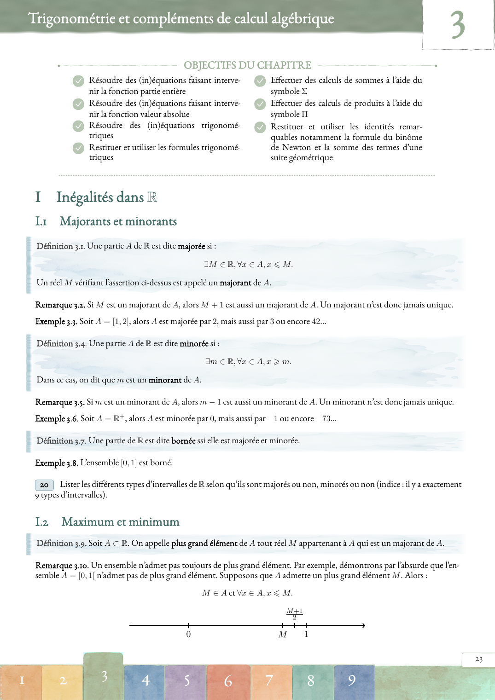
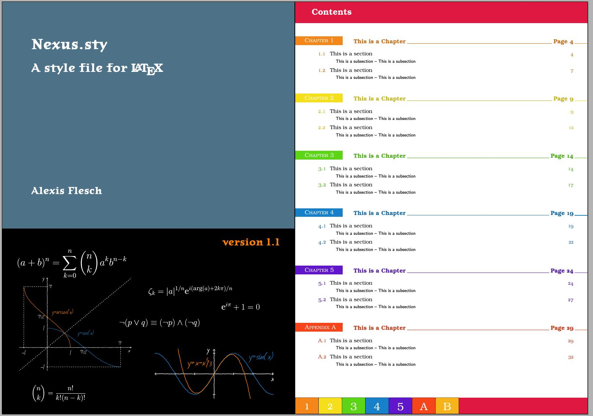
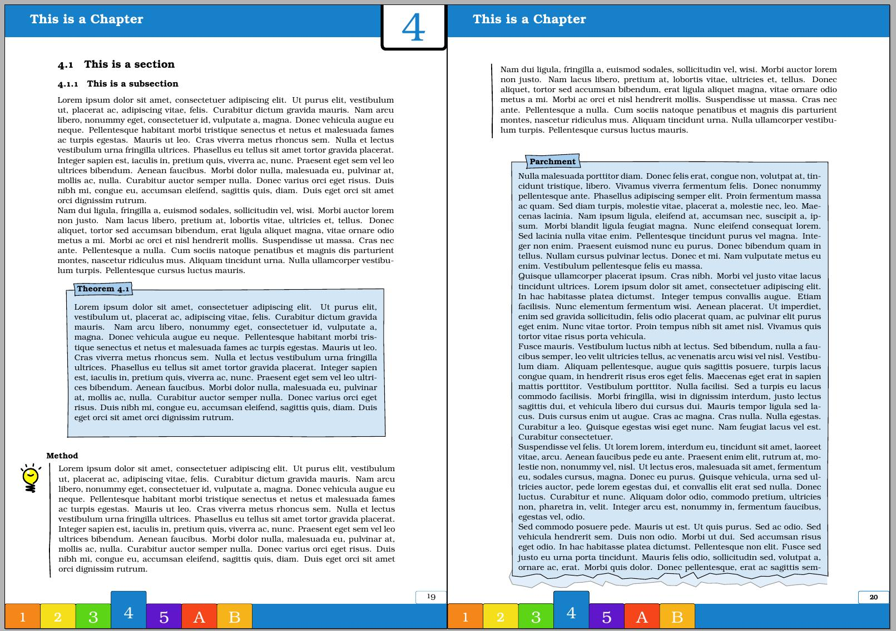

# nexus

`nexus.sty` adds chapter colors, a chapter navigation strip, headings and a table of contents to a LaTeX book. The original colorful style remains available. `nexus-aquarelle.sty` is an optional watercolor variant with painted chapter headers and footers, pencil-like outlines and quiet backgrounds for important boxes.



The preview is an image from a mathematics course. The course sources are not included in this repository.

## Usage

Compile with **XeLaTeX** (the navigation links use `\XeTeXLinkBox`; the watercolor variant also uses `fontspec`). Load the packages in this order:

```latex
\documentclass{book}
\usepackage{hyperref}
\usepackage[palette=ebis,reclength=.08\paperwidth]{nexus}
\usepackage{nexus-aquarelle} % optional
\begin{document}
\tableofcontents
\chapter{First chapter}
\section{A section}
Some text.
\end{document}
```

`nexus` accepts `palette=<name>` and `reclength=<length>`. The default palette is `ebis`; the other palettes are defined in `nexus.sty`. Without `nexus-aquarelle`, the classic design is used. The watercolor variant follows the active chapter color in the header and footer and keeps the chapter links clickable. It uses pre-rendered PNG washes for the large painted areas, so the brush textures do not have to be redrawn by TikZ on each page.

The watercolor variant colors section headings by default. For dark, neutral headings, use:

```latex
\usepackage[sectionsneutres]{nexus-aquarelle}
```

`sectionscolorees` explicitly restores the default. The variant also restyles the course environments named `definition`, `definitions`, `illustration`, `exercice`, `definitionb`, `proposition`, `theoreme`, `corollairei`, `proprietei` and `proprietesi` **when they exist**. Define them before loading `nexus-aquarelle`. The theorem boxes in the preview are declared with [xeboiboites](https://github.com/alexisflesch/xeboiboites) 1.2. Examples and exercises remain unpainted; the blue wash is reserved for definitions and theorem boxes.

## Installation

Keep `nexus-aquarelle.sty` and the complete `aquarelle/` directory together. For a local TeX installation:

```sh
texmf="$(kpsewhich -var-value TEXMFHOME)/tex/latex/nexus"
mkdir -p "$texmf"
cp nexus.sty nexus-aquarelle.sty "$texmf/"
cp -R aquarelle "$texmf/"
```

Alternatively, put this repository on TeX's search path with `TEXINPUTS=/path/to/nexus//:`. Compile twice for the chapter counters and links. `nexus-aquarelle` requires a reasonably recent `tcolorbox`, `tikz`, `fontspec`, `etoolbox`, `xparse`, `graphicx`, `xcolor` and `needspace` installation. EB Garamond is used when it is installed at the expected system path; otherwise the theme uses TeX Gyre Pagella.

## Classic preview




The original [example PDF](example.pdf) shows the classic style. Its boxes use [xeboiboites](https://github.com/alexisflesch/xeboiboites).

## License

LaTeX Project Public License 1.3c.
